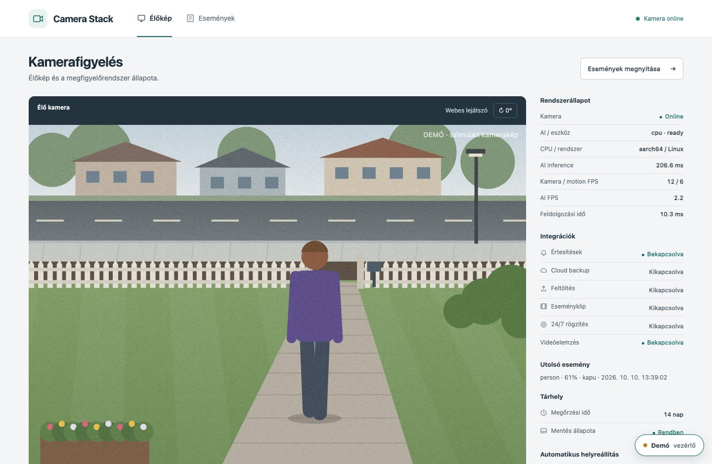

# Camera Stack

Docker-first, helyben futó RTSP kameramegfigyelő Raspberry Pi 4-re, Macre és
Linuxra. OpenCV mozgásérzékelés után YOLO11n validálja az embereket; megerősített
eseménynél snapshotot és adatbázis-bejegyzést készít. FastAPI web UI, opcionális
ntfy, eseményklip, folyamatos rögzítés és rclone backup egyetlen image-ben.

Alapbeállítás: **csak ember**, **teljes kép egy zóna**, **2 pozitív az utolsó
3 AI frame-ből**. Videórögzítés, notification és backup alapból kikapcsolva.

> *English: a self-hosted home surveillance stack for the Raspberry Pi 4 (motion detection,
> YOLO11n person validation, event snapshots, ntfy alerts, recovery watchdog). The UI and
> docs are in Hungarian. **Try the live demo in your browser, no install needed.***

## ▶ Próbáld ki: élő demó, telepítés nélkül

**[Demó megnyitása a böngészőben →](https://lugosidomotor.github.io/raspberry-pi-surveillance/)**

[](https://lugosidomotor.github.io/raspberry-pi-surveillance/)

A demó a **valódi webes felület** változatlan kódja (`app/static`). A Raspberry Pit,
a kamerát és a szervert a böngésző szimulálja, így nincs szükség Pi-re, Dockerre
vagy kamerára. A jobb alsó **Demó · vezérlő** gombbal kipróbálhatod:

- **Valaki megjelenik a képen:** látogató, járókelő, autó vagy macska. Pár
  másodperc múlva esemény lesz belőle, snapshottal, montázzsal, 10 mp-es klippel
  és szimulált videóelemzéssel. A képekre kattintva megnyílnak.
- **Hibahelyzetek:** kamerakiesés vagy GPU-firmware-lefagyás. Ilyenkor látszik,
  ahogy a helyreállító felügyelő újraindítja a kameraforrást vagy az egész Pi-t,
  a valódi korlátokkal együtt: 30 percenként legfeljebb egyszer, naponta
  legfeljebb háromszor.
- **Állapotok:** teszt stream, gyenge táp, magas hőmérséklet, kevés tárhely,
  hiányzó élőkép-cím, valamint a kép forgatása és az eseménynapló lapozása.

Offline is működik: töltsd le a [`demo/camera-stack-demo.html`](demo/camera-stack-demo.html)
fájlt, és nyisd meg duplakattintással. A demó a felület kódjából készül
(`python tools/build_demo.py`), a CI pedig ellenőrzi, hogy naprakész-e.

## Gyors indítás

Docker Desktop Macen, vagy Docker Engine + Compose plugin Linuxon szükséges.
Minden parancsot a repository gyökeréből futtass; nincs külön második projekt.

```bash
cp .env.example .env
chmod 600 .env
# Szerkeszd .env-et: CAMERA_URL=<teljes, aktuális RTSP URL>
mkdir -p data
docker compose up --build -d
docker compose logs -f camera
```

UI: **http://127.0.0.1:8000**. A webes élőképhez külön `LIVE_STREAM_URL` kell;
ennek hiányában a státusz és az eseménylista működik, a player nem jelenít videót.
Meglévő `.env`-et ne írj felül: azt szerkeszd.

```bash
docker compose ps
curl http://127.0.0.1:8000/health
docker compose stop
docker compose down
```

A `down` nem törli a `data/` tartalmát. A Docker build letölti a modellt és a
függőségeket; ehhez internet és több GB szabad hely kell. Mac Dockerben CPU fut,
az Apple MPS nem érhető el a Linux VM-ben. Az image ARM64 és AMD64 kompatibilis.
Az alap Docker image **natív NCNN**, Torch nélkül, 320-as YOLO11n bemenettel.
A PyTorch exportáló és FFmpeg-fordító eszközök csak builder stage-ekben vannak;
az első build átmenetileg sokkal több tárhelyet használ, mint a kész image.
Az opcionális nagyobb PyTorch image-hez:

```bash
docker compose -f docker-compose.yml -f docker-compose.pytorch.yml up --build -d
```

Natív macOS PyTorch futtatásnál a `.env`-ben `AI_BACKEND=ultralytics` szükséges.
A méretoptimalizálás részletei: [Docker image és tárhely](docs/DOCKER_SIZE.md).

## Projektstruktúra

```text
.
├── app/                   # Egyetlen alkalmazás, moduláris Python backend
│   ├── main.py            # Belépési pont: python -m app.main
│   ├── config.py          # Defaults → YAML → env
│   ├── camera.py          # RTSP reader, latest frame, reconnect
│   ├── motion.py          # MOG2, mozgási régió, crop
│   ├── detector.py        # ObjectDetector absztrakció + Ultralytics
│   ├── validator.py       # Többképes megerősítés
│   ├── zones.py           # Rectangle/polygon ROI
│   ├── events.py          # Snapshot + SQLite eseménytár
│   ├── recorder.py        # FFmpeg eseményklip és folyamatos rögzítés
│   ├── notifier.py        # ntfy adapter
│   ├── uploader.py        # rclone feltöltés
│   ├── hardware.py        # Raspberry Pi host diagnosztika
│   ├── runtime.py         # Pipeline és worker életciklus
│   ├── web.py             # FastAPI web/API
│   ├── utils.py           # Logging, állapot, worker segédek
│   └── static/            # HTML, CSS, JS, ikon
├── tests/                 # Kamera nélkül futó unit tesztek
├── deploy/pi/             # Host CSI adapter + MediaMTX config
├── demo/                  # Önálló, böngészőben futó demó (generált, egy fájl)
├── tools/                 # Tesztvideó-előkészítés, demóépítés (tools/demo/: mock backend)
├── docs/                  # Tesztelés és UI dokumentáció
├── data/.gitkeep          # Privát runtime adatok; Git kizárja a tartalmat
├── .github/workflows/     # Dockeres CI
├── .env.example           # Üres, dokumentált konfigurációs sablon
├── config.yaml            # AI/motion és opcionális zónák
├── Dockerfile             # production és test target
├── docker-compose.yml
├── docker-compose.pi.yml  # Opcionális read-only Pi modellmount
├── requirements.txt
├── pyproject.toml
└── SECURITY.md
```

## Működés

```text
Kamera / Raspberry Pi host (rpicam + MediaMTX)
                    ↓ RTSP
Docker: reader → OpenCV motion → crop → YOLO11n → temporal validation
                                                      ↓
                                           snapshot + SQLite + web UI
                                                      ↓
                                       ┌ ntfy / FFmpeg / rclone
                                       └ külön person-klip → OpenRouter (kulccsal)
```

Nincs közvetlen CSI vagy Picamera2 függőség. MediaMTX és Tailscale a hoston fut,
nem ebben az image-ben. A webes player az RTSP feldolgozástól független.

A mozgásdetektor legfeljebb 640 px széles képen dolgozik. Alapból 3000 px-es
kontúrterületet és 3 egymást követő mozgásos frame-et kér, 30 frame-es induló
háttértanulás után. Az utolsó megerősített mozgás után még 10 másodpercig tartja
nyitva az AI kaput. A túl apró, távoli alak elkerülheti a motion küszöböt.

YOLO: 320-as input, 0,75 confidence, maximum 3 inference-indítás/másodperc.
A tényleges sebesség hardverfüggő. Két pozitív AI-vizsgálat már elég: nem kell
megvárni a harmadikat. Ez nem személyazonosítás és nem egyedi objektumkövetés.
Több ember esetén osztály/zónánként a legbiztosabb aktuális találat kerül az
eseménybe. `EVENT_COOLDOWN_SECONDS=30` korlátozza az ismételt eseményeket.

## Konfiguráció

Teljes lista: [.env.example](.env.example). Precedencia: defaults → YAML → env.

| Beállítás | Viselkedés |
| --- | --- |
| `CAMERA_URL` | Kötelező env; hiánya értelmes indulási hibát ad |
| `AI_TRACK_OBJECTS=person` | Csak emberek váltanak ki eseményt |
| `NTFY_URL` + `NTFY_TOPIC` | Mindkettő kell; token opcionális |
| `BACKUP_ENABLED=true` + remote + path | Mindhárom kell; különben disabled |
| `RECORD_EVENTS=true` | Eseményklip, alapból false |
| `OPENROUTER_API_KEY` | Opcionális: embereseménynél 10 mp-es külön klipet rögzít, majd tevékenységleírást kér; hiányában nincs plusz rögzítés vagy API-hívás |
| `ACTIVITY_LLM_MODELS` | Sorrendben próbált modellek; API-hiba vagy érvénytelen válasz esetén továbblép a következőre |
| `ACTIVITY_LLM_TIMEOUT_SECONDS` | Időtúllépés modellenként, alapértelmezés: 75 mp |
| `CONTINUOUS_RECORDING=true` | Folyamatos rögzítés, alapból false |
| `LIVE_STREAM_URL` | Beágyazott lejátszóoldal; hiányában nincs élőkép |
| `WEB_BIND_ADDRESS` | Host portkötés; alapból 127.0.0.1 |

Opcionális integráció hiánya nem startup hiba. Hibás megadott tuningérték
viszont az. A recording/backup kapcsolók és credentialök environment-only
értékek. Compose a `data/`-t `/data`-ra mountolja. Env változtatás után:

Az OpenRouter-kulcsot csak a host `.env` fájljába írd, amely `0600` jogosultságú
és a Gitből kizárt. Az elemző worker a kamera feldolgozásától függetlenül fut.
Validált `person` eseménynél külön, 10 másodperces MP4-et rögzít 5 FPS-sel,
legfeljebb 960 pixel szélességgel. A klipet base64 videóbemenetként küldi az
OpenRouternek; a leírás és az elemzett klip az eseménysorban jelenik meg.
Elsőként Gemma 4 31B, hiba vagy hibás válasz után Gemma 4 26B következik; mindkettő
ingyenes (`:free`), de gyakran rate-limitelt. Tartaléknak a fizetős `qwen/qwen3.7-flash`
fut (klipenként nagyjából 0,0002 $), csak ha mindkét ingyenes modell elbukott.
Az elemzés `Gyanús` vagy `Nem gyanús` besorolással kezdődik, rövid, látható
bizonyítékra szorítkozó indoklással. Sikeres elemzés után külön, szöveges ntfy
üzenet érkezik ugyanarra a topicra; órán gyorsan átfutható, a címe 🛑 (gyanús,
high priority) vagy ✅ (nem gyanús) emojival kezdődik. Ez az üzenet az eredeti
mozgásértesítéstől független.
Mindhárom sikertelen próbája után a kamera és a meglévő riasztás változatlanul
működik, az esemény sorában az elemzés hibája látszik. Az activity klip a helyi
14 napos retenció alá esik, és ha külön cloud backup aktív, az lezárás után azt
is feltölti. Csak akkor kapcsol be, ha `OPENROUTER_API_KEY` nem üres.

```bash
docker compose up -d --force-recreate
```

### Csendes (alacsony megbízhatóságú) események

`AI_RECORD_CONFIDENCE` (pl. 0.10) és `AI_CONFIDENCE` (pl. 0.50) között az ember-találat
csendes eseményt ad: snapshot, 10 s-os klip és montázs készül, de semmilyen értesítés nem megy
ki, és az LLM-elemzés is kimarad. Ugyanúgy kell 3-ból 2 képkocka, zónánként legfeljebb 30 s-onként.
Ha az epizód közben a megbízhatóság eléri az `AI_CONFIDENCE`-t, normál esemény indul a szokásos
riasztással, elemzéssel és ítélettel; a csendes cooldown ezt nem blokkolja, és a futó montázs
értesítése is kimegy. Átbillenéskor az LLM a csendes klip és az új klip újrakódolás nélkül
összefűzött, kb. 20 s-os változatát elemzi (ha a csendes esemény az elmúlt cooldown + 5 s-ban
volt), így az átbillenés előtti rész is számít; sikertelen összefűzésnél a 10 s-os klipet.
A UI-ban a csendes esemény „🔕 Értesítés: csendes” jelölést kap.
Alapból kikapcsolva (`0`).

### Képforgatás

Az élőkép fejlécében a „↻” gomb 90°-onként, az óramutató járása szerint forgatja a képet,
újraindítás nélkül. A forgatás az élőképre, a mozgásérzékelésre, az AI-ra, a snapshotokra,
a montázsra és az értesítésekre is érvényes, így oldalra szerelt kameránál is álló embert lát
a modell. A választás a `data/settings.json`-ban marad meg; kezdőértéke `CAMERA_ROTATION`.
Az elemzési klip és a rögzített videó forgatás nélkül készül (stream-másolat, illetve a
beépített FFmpeg nem tartalmaz forgató szűrőt).

### Automatikus helyreállítás

Firmware-lefagyás vagy tartósan hiányzó kamerakép esetén a hoston futó `camera-watchdog` előbb a
kameraforrást, szükség esetén a Pi-t indítja újra (korlátozott gyakorisággal); a hardveres watchdog
a beragadt újraindítást is feloldja. A host-oldali beállításokat (ezt is) egy lépésben a
`deploy/pi/install-host.sh` végzi; szabályok: [docs/CAMERA_SOURCE.md](docs/CAMERA_SOURCE.md).
A UI „Automatikus helyreállítás” widgetje mutatja az állapotot, és ott kapcsolható ki az újraindítás.

### Mozgásmontázs

Validált `person` eseménytől addig, amíg 60 s-ig nincs mozgás (`MONTAGE_IDLE_SECONDS`,
legfeljebb 5 percig), az app mozgás közben másodpercenként egy 480 px széles képkockát gyűjt.
A csendes szakasz nem ad üres képet; aki egy percen belül visszatér, ugyanabba a montázsba
kerül, így az esemény-cooldown alatti visszatérés sem vész el. Hosszú
epizódnál a gyűjtés ritkul, így legfeljebb 16 kép fedi le egyenletesen a teljes időt.
A végén időbélyeges rácsot ment `events/<nap>/<esemény>_montage.jpg` néven,
és ntfy-csatolmányként elküldi („🎞️ Mozgás vége · N kép”). Az epizód közbeni további
események ugyanahhoz a montázshoz csatlakoznak. A montázs az eseménnyel együtt jár le,
backup esetén feltöltődik, és az eseménysorban „Montázs ↗” linkként jelenik meg.
Kikapcsolás: `MONTAGE_ENABLED=false`.

### Zónák

`config.yaml`: `zones: []` = teljes kép egyetlen `full_frame` zóna.
Egyedi ROI opcionális; koordinátái normalizált 0..1 értékek. Az objektum
keretének alsó középpontja alapján az első megfelelő osztályszabály nyer.
Konfigurált zónákon kívül nincs esemény.

```yaml
zones:
  - name: entrance
    rectangle: [0, 0.25, 0.5, 1]
    rules: {person: event}
  - name: sidewalk
    rectangle: [0.5, 0, 1, 1]
    rules: {person: ignore}
```

A `notify`, `record`, `snapshot` és `event` szabályok engedélyezik az eseményt;
az értesítést/rögzítést továbbra is a globális env kapcsoló vezérli.

## Raspberry Pi telepítés

64 bites Raspberry Pi OS és működő Docker + Compose szükséges. Docker telepítés:
[hivatalos Debian útmutató](https://docs.docker.com/engine/install/debian/).
A container saját Python 3.11-et hoz; nem használja a host Pythonját.

```bash
uname -m                     # aarch64
docker version
docker compose version
id -u
id -g
cp .env.example .env
chmod 600 .env
mkdir -p data
```

`.env`-ben töltsd ki a kamera URL-t, és `APP_UID`/`APP_GID` értékét a saját
nem root felhasználód számaival. Pi 4-en kezdésnek `AI_MAX_FPS=2` ajánlott.
Az OpenRouter kiegészítő kipróbálásához az `OPENROUTER_API_KEY` kulcsot is a
Pi `.env` fájljába írd; a fájl maradjon `0600` módú és gitignore alatt.
A data könyvtár ennek a felhasználónak legyen írható.

A mozgásvizsgálat alapértelmezetten legfeljebb **8 FPS** (`MOTION_MAX_FPS=8`,
YAML: `motion.max_fps`). A kihagyott képkockák helyett mindig a legfrissebbet
vizsgálja; ez nem lassítja az élőképet vagy a rögzítést, és az AI külön
`AI_MAX_FPS` korlátja megmarad. A három mozgásmegerősítő képkocka kb.
0,25–0,375 másodpercet igényel 8 FPS mellett; a 30 képkockás kezdeti
háttértanulás kb. 4 másodperc (az AI és a tényleges terhelés ezt növelheti).
Az RTSP dekódolása továbbra is teljes sebességgel fut, így annak CPU-igényét
ez önmagában nem csökkenti. `.env` módosítás után `docker compose up -d
--no-build --force-recreate camera` szükséges, nem elég a sima restart.

Pi hardverpanelhez a `.env`-ben:

```dotenv
COMPOSE_FILE=docker-compose.yml:docker-compose.pi.yml
```

```bash
docker compose up --build -d
```

A read-only modellmount nem kér privileged módot. A panel host CPU/RAM,
hőmérséklet, órajel, load, uptime és az adatlemez szabad helyét mutatja.
Más hoston rejtett; hiányzó szenzor nem állítja le az alkalmazást.

Host oldali RTSP-hez például `CAMERA_URL=rtsp://pi.local:8554/cam`. A container
`127.0.0.1` címe nem a hostot jelenti. Macen host szolgáltatáshoz használható a
`host.docker.internal`. IMX219 kamerát a host MediaMTX/rpicam rétege kezel.

### ARM64 / AMD64 build

```bash
docker buildx build --platform linux/arm64 -t camera-stack:local --load .
docker buildx build --platform linux/amd64 -t camera-stack:amd64 --load .
```

Az alapimage Torch nélküli NCNN-t használ. CUDA-hoz külön GPU-képes derived image
és runtime szükséges. A `ObjectDetector` adapter később exportált modellekhez
és más backendhez bővíthető; NCNN külön targetben elérhető, TFLite/Coral nincs
az alapimage-ben.

### Pi: NCNN és gyors helyi reconnect

A külön NCNN target ugyanazt a YOLO11n modellt exportálja 320×320-ra, és
build során becsomagolja az NCNN runtime-ot. A PyTorch alapimage változatlanul
elérhető. A Pi `.env` fájljában:

```dotenv
COMPOSE_FILE=docker-compose.yml:docker-compose.pi.yml:docker-compose.stream.yml:docker-compose.ncnn.yml
COMPOSE_PROFILES=test-source
```

```bash
docker compose up --build -d
```

A stream override egy Compose-projektbe teszi a `camera`, `mediamtx` és
`publisher` szolgáltatásokat. `docker compose restart publisher` csak a
tesztvideót indítja újra. CSI-kameránál a profil legyen üres, a capture-t a
host adapter indítsa. Részletek: [üzemeltetés](docs/CAMERA_SOURCE.md),
[teljes architektúra-diagram](docs/ARCHITECTURE.md).

A helyi-stream override a reconnect várakozását 1, majd maximum 2 másodpercre
korlátozza. Publikus, instabil RTSP feednél hagyd el ezt az override-ot; ott
marad a 30 másodperces maximum. Az open/read timeout külön beállítás.
NCNN: CPU, fix 320-as négyzetes bemenet; a confidence és a 2/3 validáció nem
változik. Új mérethez újra kell exportálni a modellt. PyTorch-hoz az NCNN helyett
a `docker-compose.pytorch.yml` override-ot használd, és recreate-eld a konténereket.
Natív NCNN-inference alapból két CPU-szálon, Torch import nélkül. Mérés és
backendkorlátok: [docs/BACKENDS.md](docs/BACKENDS.md).
[Ultralytics NCNN export](https://docs.ultralytics.com/integrations/ncnn/).

## Web UI és távoli elérés

Útvonalak: `/`, `/events`, `/health`, `/api/status`, `/api/events`.
Az UI ötmásodpercenként frissül. Nincs beépített login: lásd [SECURITY.md](SECURITY.md).

Minden host interfészről történő eléréshez:

```dotenv
WEB_BIND_ADDRESS=0.0.0.0
WEB_HOST_PORT=8000
```

Ez a LAN felől is elérhetővé teszi a `http://<PI-IP>:8000` címet. Ne nyiss
hozzá internetes router portforwardot. Privát HTTPS-hez tartsd meg a loopback
kötést, és a Tailscale hoston futtasd:

```bash
sudo tailscale serve --bg http://127.0.0.1:8000
tailscale serve status
```

### Élőkép

Az alkalmazás nem konvertál RTSP-t böngészős streammé. `LIVE_STREAM_URL` egy
MediaMTX HLS/WebRTC **playeroldal** URL-je, például `http://pi.local:8888/cam`.
Nyers `.m3u8` vagy WHEP endpoint nem iframe player. A címet a böngészőnek kell
elérnie; HTTPS UI alatt a player is legyen HTTPS, különben mixed-content hiba
lehet. [MediaMTX dokumentáció](https://mediamtx.org/docs/usage/read-stream#web-browsers).

## ntfy értesítés

```dotenv
NTFY_URL=https://ntfy.sh
NTFY_TOPIC=<sajat-topic>
NTFY_TOKEN=
NOTIFICATION_COOLDOWN_SECONDS=60
```

Valid eseményről high-priority üzenet és JPEG snapshot megy, nem videó.
Osztály/zóna szerinti cooldown az utolsó sikeres küldéstől számít.
A notification worker nem blokkolja az AI-t. A sikertelen küldés naplózódik;
nincs tartós notification retry queue.

## Videó és backup

```dotenv
RECORD_EVENTS=true
RECORD_CLIP_SECONDS=30
CONTINUOUS_RECORDING=true
RECORDING_SEGMENT_SECONDS=300
RECORD_PRE_ROLL_SECONDS=5
RETENTION_DAYS=14
MIN_FREE_DISK_MB=512
```

FFmpeg `-c copy`, videó-only MP4; nincs újrakódolás. Eseményrögzítéskor egy
rövid, 2 másodperces szegmensekből álló helyi körpuffer ad pre-rollt. A lezárt,
friss szegmenseket az esemény kezdetén védett hardlinkek rögzítik, majd a klip
végén FFmpeg összefűzi őket az esemény utáni videóval. A puffer indulása vagy
streamkiesés után nem feltétlenül van elegendő előzmény; hosszú GOP esetén a
pre-roll hossza közelítő. `RECORD_PRE_ROLL_SECONDS=0` kikapcsolja.
A puffer, az eseményklip és a folyamatos recorder külön RTSP kapcsolatot használ.
A folyamatos szegmensek
kulcsképkockánál záródnak, nem feltétlenül pontosan 300 másodpercnél.
Csak lezárt `.mp4` kerül a backupba, aktív `.tmp` nem.

A 24/7 rögzítés és cloud backup párhuzamosan működik. **Alapértelmezett helyi
megőrzés: 14 nap**, `RETENTION_DAYS` envvel állítható pozitív egész napra.
A web UI kiírja az értéket. Induláskor és óránként törlődnek a lejárt snapshotok,
thumbnailök, lezárt klipek, folyamatos felvételek és a hozzájuk tartozó eseménysorok.
Ez végleges helyi törlés; a távoli backuphoz nem nyúl. A még fel nem töltött,
lejárt média is törlődik: a retention a helyi tárhely elsődleges szabálya.
Aktív `.tmp` fájlhoz vagy folyamatban lévő uploadhoz nem nyúl.
`MIN_FREE_DISK_MB=512` alatt a snapshot/videó mentés szünetel, a kamera és AI
tovább működik; helyreálláskor a mentés folytatódik. Nincs fiatalabb felvételeket
törlő méretkvóta. Az adatbázisnak/lognak továbbra is kell szabad hely.

Módosítás: állítsd például `RETENTION_DAYS=7` értékre a `.env` fájlban, majd:

```bash
docker compose up -d --no-build --force-recreate
```

A sima `docker compose restart` nem tölti újra a konténer env értékeit.
Részletek és helyreállítás: [docs/RELIABILITY.md](docs/RELIABILITY.md).

IP-kamera substream esetén `CAMERA_URL` legyen az alacsonyabb felbontású
észlelési stream, `RECORDING_CAMERA_URL` pedig a fő stream. Üres értéknél ugyanazt
a streamet használják. A CSI publisher jelenleg egy 720p streamet ad.

### Hetzner Storage Box / rclone

Az image tartalmazza az rclone-t. Előbb állíts be egy remote-ot:

```bash
mkdir -p data/rclone
docker run --rm -it --user "$(id -u):$(id -g)" \
  -v "$PWD/data/rclone:/config" --entrypoint rclone camera-stack:local \
  config --config /config/rclone.conf
```

Válassz `storage` nevű SFTP remote-ot saját Storage Box hosttal és credentiallel.
A rclone config privát, a kizárt `data/` alatt marad. Ellenőrizd a host
fingerprintet és a szolgáltatód SSH/SFTP portbeállítását.

```dotenv
BACKUP_ENABLED=true
BACKUP_REMOTE=storage:
BACKUP_PATH=camera-archive/pi4
DELETE_AFTER_UPLOAD=false
RCLONE_CONFIG=/data/rclone/rclone.conf
```

```bash
docker compose run --rm --entrypoint rclone camera lsd storage:
docker compose up -d --force-recreate
```

`copyto`, nem `sync`: távoli fájlt nem töröl. Hibás feltöltést újrapróbál,
a ledger újraindítás után megmarad. `DELETE_AFTER_UPLOAD=true` csak sikeresen
feltöltött **videót** töröl; a snapshot megmarad. A törölt helyi videó UI-linkje
nem lesz lejátszható. [rclone SFTP dokumentáció](https://rclone.org/sftp/).

## Tesztelés és fejlesztés

Nem kell host Python, külön venv vagy kézi segédscript:

```bash
docker build --target test -t camera-stack:test .
docker run --rm --network none camera-stack:test
docker compose build
docker compose up -d
```

Pi kameraforrás, HLS/WebRTC és végtelenített videófallback:
[docs/CAMERA_SOURCE.md](docs/CAMERA_SOURCE.md). A forrásréteg a hoston fut,
elkülönül a Dockeres AI alkalmazástól.

Részletek: [docs/TESTING.md](docs/TESTING.md). GitHub Actions ugyanezeket a
Dockeres unit teszteket futtatja; nem használ élő kamerát vagy valódi titkot.
UI-dokumentáció: [docs/DESIGN.md](docs/DESIGN.md),
[docs/HARDWARE_UI.md](docs/HARDWARE_UI.md).

## Hibakeresés és üzemeltetés

- `CAMERA_URL is required`: töltsd ki `.env`-ben, majd recreate.
- `401 Unauthorized`: lejárt RTSP token vagy rossz credential. Friss URL-t
  csak `.env`-be írj, ne forráskódba vagy GitHub issue-ba.
- Offline kamera: a reader 1, 2, 5, 10, 20, majd maximum 30 másodperc után
  újrapróbálkozik; a web UI működik tovább.
- `Permission denied /data`: egyeztesd a Linux UID/GID-t és a data tulajdonosát.
- Nincs esemény: motion warmup, min area, confidence, crop és zónaszabályok
  ellenőrzése. Teljes AI képhez `AI_CROP_MOTION=false`.
- Backup disabled: enabled=true, remote és path egyaránt szükséges.
- A healthcheck offline kameránál is 200, ha a pipeline működik; fatal
  pipeline hibánál 503. Docker unhealthy önmagában nem restartol processzt;
  a pipeline saját backoff retryval próbál helyreállni.
- Normál stopnál FFmpeg lezár, worker queue ürül, upload határidőt kap.
  Áramszünet után maradó `.tmp` nem kerül automatikusan feltöltésre.
- A `data/` tárolja a snapshotokat, videókat, SQLite-ot és rotált logokat.
  A `docker compose logs` kimenetét megosztás előtt tisztítsd meg a titkoktól.

## Publikus repository

Csak kód, sablonok, dokumentáció és tesztek kerüljenek Gitbe. `.env`, `data/`,
modellek és fejlesztési cache-ek ki vannak zárva. Ne használd a `git add -f`-et
ezekhez. Publikálási ellenőrzőlista és licencmegjegyzés: [SECURITY.md](SECURITY.md).
