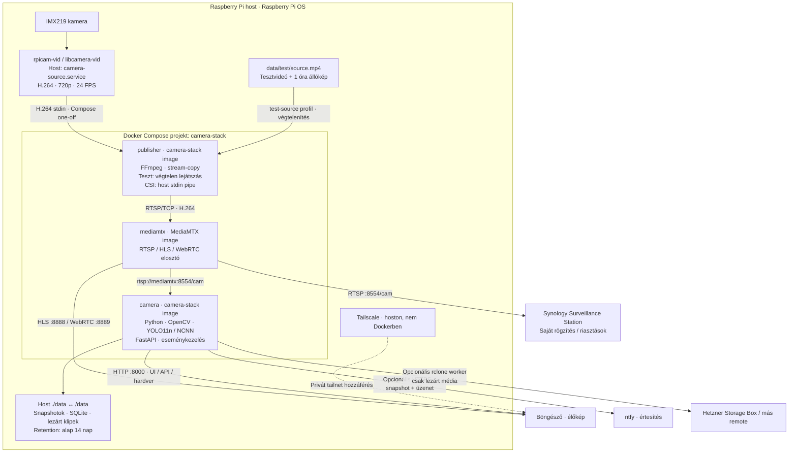
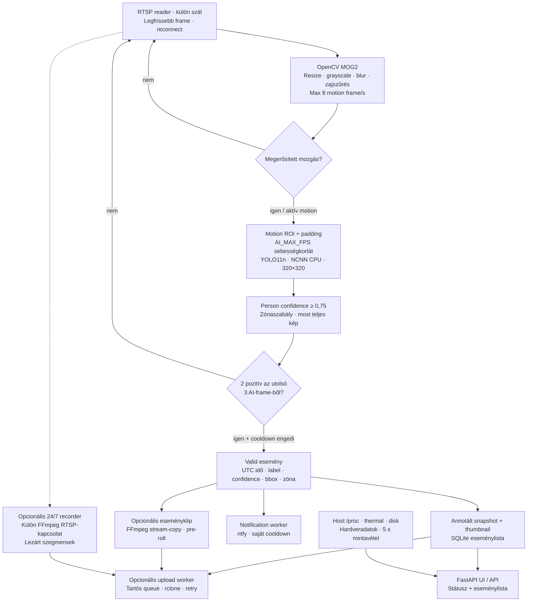

# Teljes architektúra és adatfolyam

A publisher és az app ugyanazt az image-et használja, más paranccsal.
A teszt és a CSI forrás alternatíva: nem publikálhatnak egyszerre a `cam` útvonalra.
Tesztmódban mindhárom szolgáltatást a Compose indítja. Valódi kameránál csak
a CSI capture marad a hoston; FFmpeg Compose one-off konténerben fut.

## Az elemző app belső folyamata

A motion/AI FPS-korlát nem változtatja meg az élőkép vagy a stream-copy
rögzítés minőségét/FPS-ét. A böngésző a MediaMTX videóját kapja, nem YOLO-képkockákat.
Eseményklip, 24/7 felvétel és backup párhuzamosan is működhet. Aktívan írt `.tmp`
videó nem kerül feltöltésre. A helyi retention nem törli a cloud archívumot.

A jelenlegi Pi-n tesztstream, person AI és ntfy aktív; eseményklip, 24/7
rögzítés és backup kikapcsolva. Üzemeltetés: [CAMERA_SOURCE.md](CAMERA_SOURCE.md).
